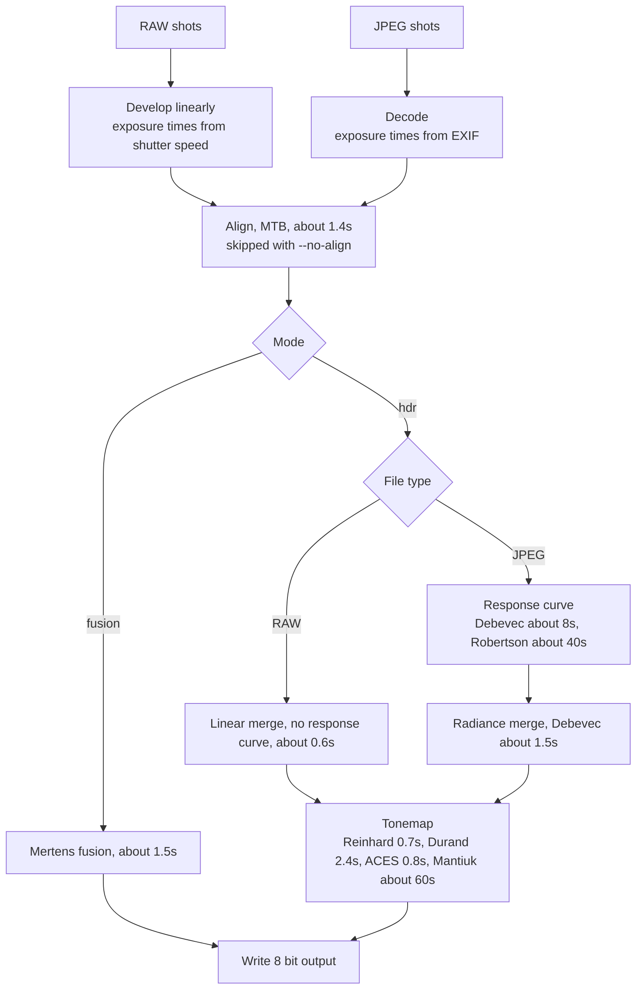

# HDR Image Creation

Sometimes you want to create amazing pictures, but unfortunately your camera simply can't handle the dynamic range in the frame you want to capture. A camera records one exposure at a time and that exposure cannot capture both the shadows and the highlights of a high-contrast scene. The shadows fall into underexposure, the highlights into overexposure. Exposure bracketing, including its automatic form (auto exposure bracketing, AEB), takes several shots of the same scene at different exposure times. A short exposure keeps the highlights while a long exposure keeps the shadows. This project combines those shots into one high dynamic range image.


## Background info

### How is a picture captured?

A camera's sensor consists of photodiodes. These photodiodes collect charge in proportion to the light that reaches them during the exposure. It converts light into electric charge, pools that charge into tiny electrical reservoirs, and measures the accumulated voltage.
Each photodiode represents one pixel. When people talk about a bigger sensor, they do not mean more photodiodes, but the photodiodes themselves are bigger. Bigger photodiodes can capture more light before it needs to clip the value (before it reaches overexposure). Additionally, in low light areas it can still capture more photons compared to smaller photodiodes allowing it to exceed the random electrical interference (read noise) more easily.
Dynamic range is essentially the ratio between the maximum amount of light a pixel can hold before clipping and the minimum noise floor.

So comparing for example our mobile phones that have e.g. 48-megapixel cameras and a proper Canon camera with also 48-megapixels, we see that the 48 million photodiodes in the phone are spread over a much smaller area than in the Canon camera. In other words, the sensor is smaller. Because they have much less space, the photodiodes need to be made smaller to fit in the phone camera resulting in a smaller dynamic range.

### How are the captured photons converted to an image?

The photodiodes convert the electric charge they captured into 14-bit (2^14=16,384 steps) through Analog-to-Digital Converter (ADC). It's possible to save these raw 14-bit values, but it would yield very big images even in the 60MB+.
Therefore, cameras often encode the light captured into for example a JPEG file. The camera applies a non-linear camera response function (CRF) that converts the 14-bit information stream into an 8-bit information stream.

### How does the camera response function (CRF) work?

A sensor captures light **linearly**. However, humans perceive light **logarithmically**. We notice the difference between a dark shadow and a slightly brighter shadow much more easily than we notice the difference between two extremely bright highlights. The CRF basically translates the linearly captured photons into a so to say logarithmic scale for humans to observe.

Professional photgraphers usually capture their images in RAW format nonetheless. The camera in that case does not apply its CRF and thus does not throw away information (keeping the 14-bit). This allows them to do professional image editing in e.g. Lightroom or Photoshop.


## Combining images for an HDR image

So in exposure bracketing, we capture multiple images of the same scene with different exposure times. There's many different ways of combining the different images:

1. Fusion blends the well-exposed regions of the shots into a displayable image from the pixel values alone. 
2. HDR mode merges the shots into a radiance map and tonemaps that map for display. 
    a. On encoded shots (e.g. JPEG) it first recovers the CRF from the exposure times in the metadata. 
    b. On RAW images it can skip estimating the CRF (as it was never applied) and directly create the radiance map.


## Running code for creating an HDR image

Paths are relative to the project root. The written file keeps the given path and adds the settings to its name.

```bash
# Fusion, the default. Writes combined_fusion.jpg.
pixi run combine-aeb-images -i burst_dir/ -o combined.jpg

# Radiance map, then tonemap. Writes combined_hdr_debevec_reinhard.jpg.
pixi run combine-aeb-images -i under.jpg normal.jpg over.jpg -m hdr -o combined.jpg
```

Further settings are in `pixi run combine-aeb-images --help`.


## Start application

### Create GCP instance
As a bonus for myself, I want to be able to use this HDR image editing from my phone when I want to. For this I will setup a GCP VM instance. You can use the script to create an instance:
```bash
cd create_machine
./create_machine.sh
```
Note that you have to set some environment variables in a `.env` file in the same folder.

### Setup instance
Afterwards you can ssh into the machine:
```bash
gcloud compute ssh --zone ${ZONE} "hdr-image-creation" --project ${PROJECT_ID} --ssh-flag="-o ServerAliveInterval=30" --ssh-flag="-o ServerAliveCountMax=3"
```
The additional ssh flags are to make sure the terminal session doesn't become unresponsive.

Finally, setup the machine with
```bash
sudo apt-get -y update
sudo apt install -y git
git clone https://github.com/VukGlisovic/computer_vision.git
cd computer_vision/hdr_image_creation/
./setup_machine.sh
```
After the setup script, the machine is ready; whenever you start the machine, the HDR image creation application is started automatically.

Note that I'm using NordVPN meshnet functionality to create my personal network sothat I'm able to access the application in the instance. You could also use other things like Tailscale to achieve the same thing.

### Reasoning behind architecture
The reason I'm doing it this way, is because I want the application to cost nothing while I'm not using it. I know I'm the only one that will be using the application, so I only need the machine to be running when I want to use it. The instance will be shut down when not in use which makes me only need to pay for the persistent disk unless you stay in the free tier.
Doing it like this prevents me from needing to pay for things like a load balancer permanently listening to my requests, no permanent IP addresses I need to pay for, etc.


## Parallelism

One thing that I wanted to know, is what machine type makes sense to use? Does it help if I add more cores? Are the algorithms parallelizable? Therefore I did a little benchmark below.

The timings below were measured with `cv2.setNumThreads` on a synthetic bracket of three 12 MP shots (4000 x 3000 pixels), on a 16-thread WSL machine. Values are in seconds. A single run can vary by around 30%, so treat them as indicative.

| Stage | Mode | 1 thread | 8 threads | 16 threads | Scales with threads |
|---|---|---|---|---|---|
| Alignment (MTB) | both | 1.4 | 1.4 | 1.4 | no |
| Mertens fusion | fusion | 3.8 | 1.5 | 1.4 | yes |
| Debevec calibration | hdr | 7.9 | 8.0 | 8.5 | no |
| Debevec merge | hdr | 1.8 | 1.3 | 1.5 | no |
| Reinhard tonemapping | hdr | 0.7 | 0.7 | 0.9 | no |
| Durand tonemapping | hdr | 2.6 | 2.4 | 2.0 | slightly |
| ACES tonemapping | hdr | 0.8 | 0.8 | 0.7 | no (NumPy) |
| 8 bit conversion | both | 0.3 | 0.4 | 0.4 | no (NumPy) |
| JPEG decode | both | 0.06 | 0.06 | 0.05 | negligible |

End-to-end timings, from loading the shots to writing the output, on the same bracket:

| Configuration | 1 thread | 8 threads | 16 threads |
|---|---|---|---|
| Fusion, aligned | 6.1 | 3.2 | 3.5 |
| Fusion, no alignment | 4.5 | 2.1 | 2.1 |
| HDR, Debevec, Reinhard | 13.6 | 12.0 | 13.4 |
| HDR, Robertson, Reinhard | 54.9 | 39.4 | 41.2 |
| HDR, Debevec, Mantiuk | 78.6 | 72.8 | 75.5 |
| HDR, Debevec, Drago | 12.7 | 11.7 | 11.4 |
| HDR, Debevec, Durand | 14.4 | 13.9 | 13.5 |
| HDR, Debevec, ACES | 18.3 | 13.6 | 11.2 |

Most important take-away: Beyond about 8 threads, most configurations gain little or nothing.

The linear merge used for raw shots takes about 0.6 s at any thread count, on synthetic readings.

Robertson calibration and Mantiuk tonemapping are much much slower than the other options. In hdr mode, Debevec calibration is the largest cost of the default path, and it does not speed up with more threads. Adding cores helps mainly fusion mode, and it helps Robertson calibration somewhat.


## Processing paths

The diagram shows which steps RAW and JPEG shots go through. The times are approximations taken from the benchmarks above.


